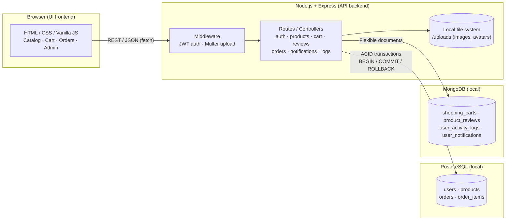
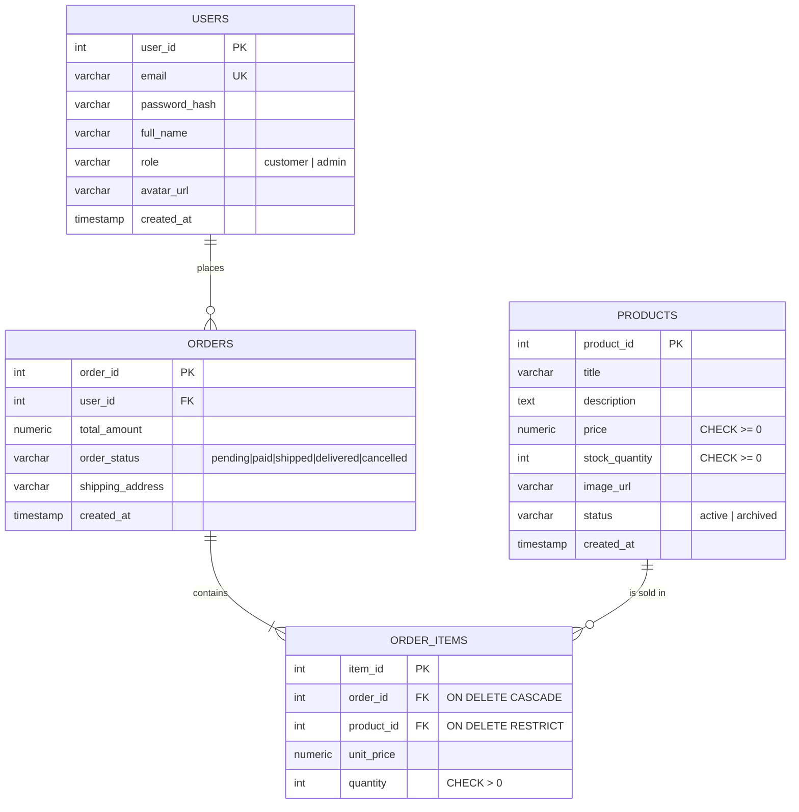
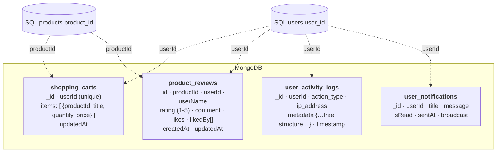
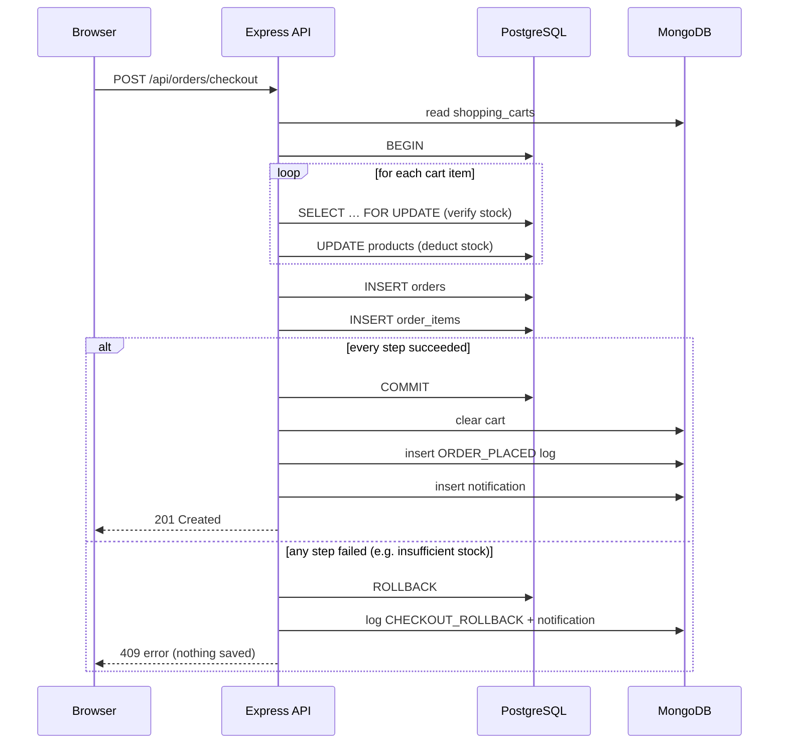

# Diagrams (Mermaid – rendered natively by GitHub)

Take a screenshot of each rendered diagram and save it in `docs/screenshots/` (e.g. `diagram-architecture.png`, `diagram-er-sql.png`, `diagram-nosql.png`).

## 1. System Architecture

## 2. SQL Entity-Relationship Diagram

## 3. NoSQL Document Schemas & Collection Flow

## 4. Checkout flow (SQL transaction + hybrid synchronisation)

